# Hi, I'm Sujan 👋

A software engineer who likes the space where **data, AI, and product design** overlap — systems that do real work behind the scenes, turned into interfaces people can actually understand and enjoy.

### `$ whoami`

### `$ contributions --graph`

### `$ ls *.sh`
<table>
  <tr>
    <td align="center"> <b>./portrait.sh</b></td>
    <td align="center"> <b>./stats.sh</b></td>
  </tr>
</table>

### `$ cat ~/.selected-dispatches`
<table>
  <tr>
    <td width="50%" valign="top">
      <h3>🏙️ <a href="https://local-lore-five.vercel.app/">Local Lore</a></h3>
      
A source-linked San Francisco discovery guide that uses an agent to research events, catch discrepancies, and keep listings fresh.

      
<code>Next.js</code> · <code>TypeScript</code> · <code>MapLibre</code> · <code>agent pipeline</code>

    </td>
    <td width="50%" valign="top">
      <h3>🔎 <a href="https://github.com/sujan-reddy-p/fedlens">FedLens</a></h3>
      
An agentic government-spending analyst that connects fiscal data with official sources and clear, reproducible explanations.

      
<code>Python</code> · <code>FastAPI</code> · <code>LangGraph</code> · <code>PostgreSQL</code>

    </td>
  </tr>
  <tr>
    <td width="50%" valign="top">
      <h3>📈 <a href="https://github.com/sujan-reddy-p/Convergence">Convergence</a></h3>
      
A research and paper-trading system that identifies specialist prediction-market wallets and measures same-side consensus.

      
<code>Python</code> · <code>Pandas</code> · <code>PyArrow</code> · <code>SQLite</code>

    </td>
    <td width="50%" valign="top">
      <h3>🧰 <a href="https://github.com/sujan-reddy-p/local-workbench">Local Workbench</a></h3>
      
A privacy-first, resumable local AI batch runner with adaptive inference limits and explicit approval for file copies.

      
<code>Python</code> · <code>Ollama</code> · <code>Textual TUI</code> · <code>SQLite</code>

    </td>
  </tr>
</table>

### `$ which tools`
- **Interfaces:** React · Next.js · TypeScript · Tailwind · motion
- **Systems & AI:** Python · FastAPI · LangGraph · PyTorch
- **Data:** PostgreSQL · SQLite · Pandas · PyArrow
- **Shipping:** Docker · Git · GitHub Actions

### `$ cat ~/awards.log`
| 🏆 | Recognition | What I built |
| :-: | --- | --- |
| 01 | **IBM Z Datathon** — 1st place, 3,000+ participants | Multi-level health analysis using medical-report data |
| 01 | **Hack-A-League** — 1st place, 200+ participants | NLP-powered semantic / plagiarism analyzer |
| 03 | **Fantom Code** — 3rd place, 3,000+ participants | Digital-asset inheritance concept on blockchain |

---

### `$ ls -lh ~/links`

  
  
  
  

🤖 This README is auto-updated daily by a GitHub Actions workflow — <code>.github/workflows/refresh-heatmap.yml</code>. The contribution SVG and stats card refresh themselves; the rest is intentionally hand-curated.
