# Hi, I'm Sujan 👋

A software engineer who likes the space where **data, AI, and product design** overlap — systems that do real work behind the scenes, turned into interfaces people can actually understand and enjoy.

### `$ whoami`

### `$ contributions --graph`

### `$ stats.sh`

